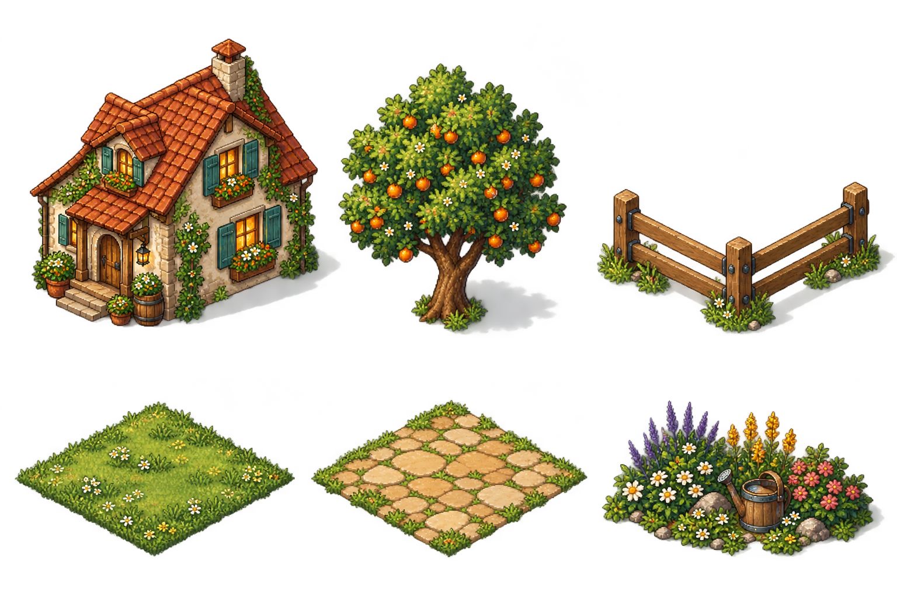
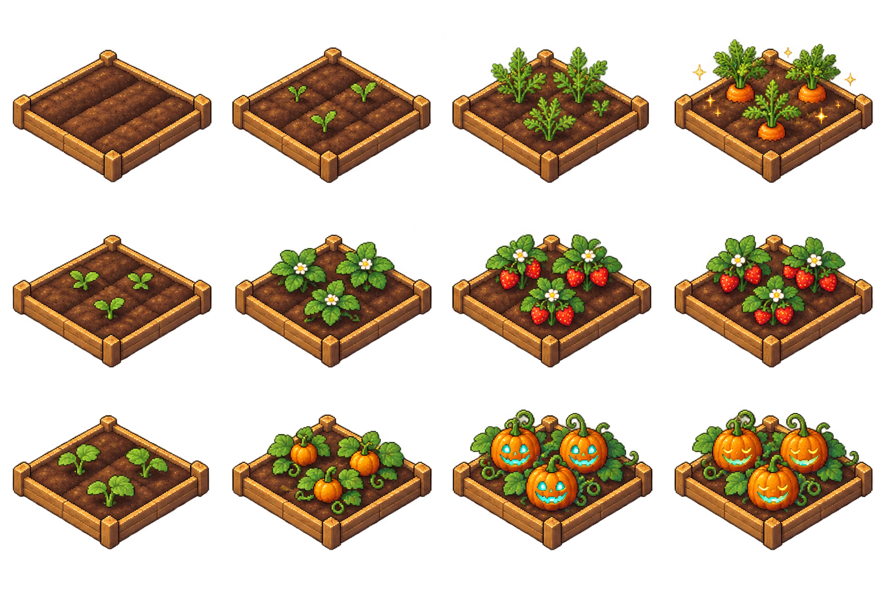
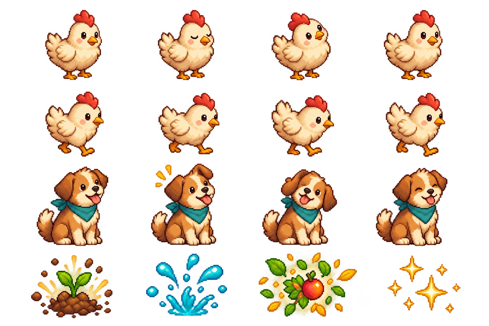
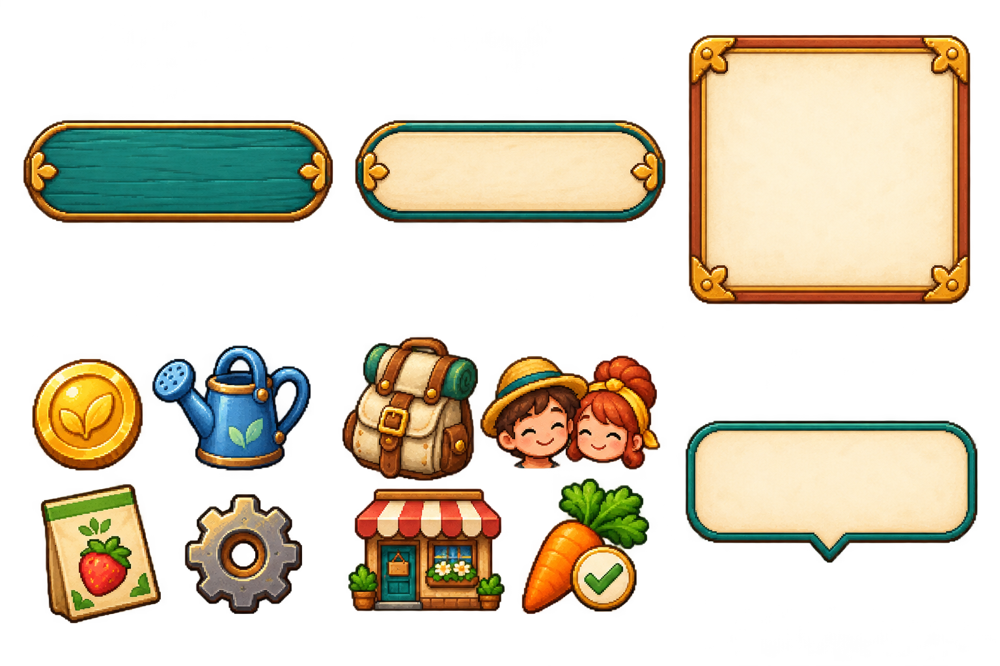

# Art Bible — Jardim do Sol / G0.5

Versão 0.1, 2026-10-22. Direção A autorizada pelo diretor. **Padrões propostos
para aprovação; nenhuma prancha gerada está aprovada como arte final.**
G0.3/G0.4 continuam disponíveis; esta amostra não altera o catálogo do GDD.

## Referência concreta

São referências produzidas para este projeto, sem referência visual de packs
ou reprodução do jogo histórico. Capturas executáveis: `.local/g0_5/index.html`,
regeneráveis por `tools/capture_art.ps1`. Pranchas não substituem essas capturas.

## Projeção, escala e profundidade

Projeção ortográfica 2:1: `screen=(64*(x-y),32*(x+y)-altura)`.
Tile-base lógico **128×64**. Não usar perspectiva convergente ou câmera rotativa.
Pivô de chão no centro da base; altura cresce verticalmente. Ordenar entidades
por x+y; evitar copa/casa sobre a área acionável dos canteiros.

| Elemento | Meta em unidades lógicas | Demonstração atual |
|---|---|---|
| Canteiro | base 180×90, passo 1,8 tile | canvas 211×187, base ~190×95 |
| Casa | largura 280–320, altura 280–320 | 300×300, ~3 tiles |
| Árvore | largura 180–220, altura 230–270 | 208×247 |
| Galinha | altura 56–68 | canvas 60×64 |
| Cachorro | altura 88–104 | canvas 95×99 |
| Cerca | altura dos postes 60–80 | peça de canto 260×156 |

Amostra de quatro canteiros é recorte de produção artística, não nova decisão
de reduzir a fazenda inicial de aproximadamente 16 canteiros.

Meta de pixels: matriz lógica comum de 128 px/tile, agrupamentos de 1–3 px,
contorno colorido 1–2 px nessa matriz. Nearest, mipmaps desligados. Na entrega
atual os sprites vieram de atlas 1536×1024 e são reduzidos no motor: **a densidade
ainda varia**, portanto não passam automaticamente na inspeção a 1×. Antes de
release, normalizar em editor de pixels e revalidar pivôs, sem suavização.
Zoom intermediário é permitido na avaliação; escala inteira é a referência de QA.

## Cor, luz e material

| Papel | Cor |
|---|---|
| Contorno/solo profundo | #44392E / #80523A |
| Folhagem | #4F7745 / #789C55 / #A4BA69 |
| Reboco/papel | #F5E6BD / #FAF2D9 |
| Telhado/cerâmica | #B96548 |
| Madeira pintada/UI | #497F78 / #254C41 |
| Recompensa e sol | #E6B35A |

Luz do alto à esquerda; sombras para baixo/direita, comprimento de até 35% da
altura do objeto, opacidade alvo 18–28%, verde/marrom escuro em vez de preto.
As sombras atuais são embutidas e discretas; revisar uniformidade manualmente.
Contorno externo mais escuro que a forma, sem preto puro generalizado. Três a
cinco tons por material como meta; atlas atual tem antialias/mais tons e pede limpeza.
Solo e telhado quentes; verde menos saturado no fundo; frutos e indicadores têm
maior contraste. Canteiros devem se distinguir com brilho e silhueta, além da cor.

Vegetação: copas em massas legíveis, 3 tamanhos de folhas, flores concentradas
em bordas. Grama quieta, sem centenas de pontos de atenção junto às culturas.
O primeiro tile do atlas tem flores demais; foi preservado como referência e
substituído no executável por textura original mais calma, `terrain_atlas_v1.png`.
Esse fundo ainda pede inspeção de emendas e densidade antes de ser arte final.
Água futura: borda clara, corpo teal de 3 tons, ciclo de 4 quadros/6 fps, sem
espelho fotográfico; **água não produzida nesta amostra**.

## Arquitetura, culturas e personagens

Casa: telha terracota, reboco creme, esquadrias teal, porta convidativa, vasos e
assimetria controlada. Sem copiar plantas, fachadas ou marcas de jogos existentes.
Cada novo prédio deve repetir materiais e direção de luz, variar função/silhueta.

Culturas: solo vazio, muda, crescimento e maturidade identificáveis em 1 s.
Cenoura: ombros laranja + folhas altas; morango: fruto vermelho + flor branca.
Solo vazio vem de uma única célula; nenhuma cultura deve deixar frutos ao colher.
Na amostra existem três plantas por imagem, apesar do briefing de geração pedir
quatro: divergência registrada, não corrigida desenhando formas sobre a prancha.

Animais: cabeça expressiva e pés claros. Galinha idle 4 quadros/2 fps, caminhar
4/6 fps; cachorro atenção/idle 4/2 fps. Frames atuais têm pequenas mudanças de
volume/posição e pedem revisão de animador; não declarar ciclos finais perfeitos.
Movimento por código posiciona sprites, não substitui desenho de frames.

Halloween: a mesma base de solo, mudas e fruto jovem; maduro com olhos teal,
blink curto a cada 4 s e variação luminosa <8%. Colheita mistura folhas douradas
e respingo teal. Não há evento, preço ou prêmio econômico. Estações futuras
mudam vegetação/ornamentos, preservando contraste de estados e projeção.

## Animação e VFX

Respostas a plantar/regar/colher acontecem no mesmo gesto, sem aguardar efeito.
VFX authored na quarta linha do atlas de animais: semente/terra, água, folhas/fruto,
brilho. Duração 0,9 s, deslocamento vertical suave e fade; máximo 32 simultâneos.
São sprites estáticos animados pelo motor, **não sequências finais de FX**.
Brilho de recompensa é só feedback visual e não altera moedas/XP.
Movimento reduzido congela animais/culturas e usa feedback sem deslocamento.

## UI, tipografia e acessibilidade

Botões teal primários, papel secundários, pressão mais escura, foco dourado,
desabilitado sem interação. Usar nine-patch da prancha original, rótulos Godot
reais e ícones próprios. Modal em papel com margem interna 36 px; tooltip em
papel com texto escuro. No kit há todos os estados e cartão de semente.
A fonte é a padrão embarcada do Godot para a avaliação (licença do motor);
família tipográfica própria ainda não selecionada.

Desktop: corpo 22–26 px, título 36–40; mobile 26–30 e título 38–40 no canvas
1080 px. Espaçamentos 8/12/24/36. HUD fixo ocupa ~25% da altura em retrato,
mapa disponível ~74%; não reduzir os mesmos componentes de desktop cegamente.
Alvos móveis >=132 px no canvas 1080 (44 dp em simulação 3×). Validar dp real
e safe-area em dispositivo; retrato em PC não comprova ergonomia física.
Tooltip por hover/hold, teclado 1/2/3/Home/setas/Enter, foco sempre visível.
Alvos de chão 196×140 lógicos, margens compartilhadas atribuídas ao centro mais
próximo (uma ação possível por ponto); zoom permite aproximação.

Critério WCAG de contraste proposto: texto comum >=4,5:1, elementos grandes e
foco >=3:1. **Auditoria completa de contraste ainda pendente**, especialmente
rótulos sobre gramado e disabled. Som nunca é a única informação. Texto/ícone,
cor de solo, silhueta e inspeção acompanham cada estado.

## Aprovação objetiva da primeira amostra

1. Quatro canteiros distinguíveis, duas culturas reconhecidas sem legenda a 1×.
2. 95% dos toques intencionais em teste humano de 20 ações acertam o alvo.
3. Nenhum clique de câmera, pinch ou modal produz ação agrícola.
4. Pivôs animais variam no máximo 1 px na escala-base entre quadros equivalentes.
5. Nenhum corte de sprites, fringe opaco, texto cortado ou controles sobrepostos.
6. Piso de 60 fps em hardware-alvo medido; sem travas em 100 ações consecutivas.
7. Termos/proveniência de todo asset, incluindo fonte e áudio, revisados.
8. Diretor aprova composição, carisma, densidade, UI e Halloween no executável.

Atualmente 4, 6 e revisão completa de 5/7 dependem de trabalho/teste humano.
O relatório separa evidência automatizada, limitações e aprovação artística.
